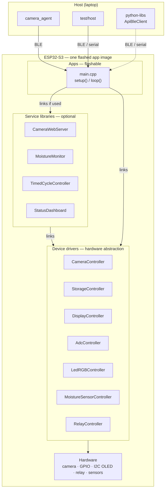
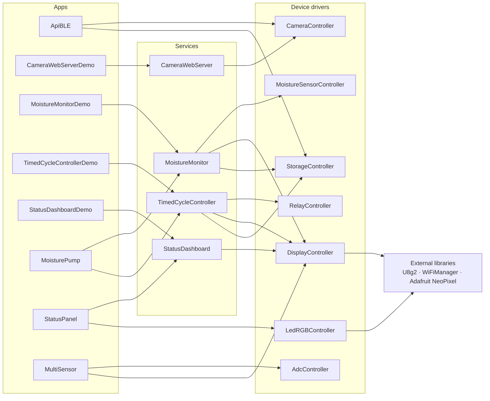
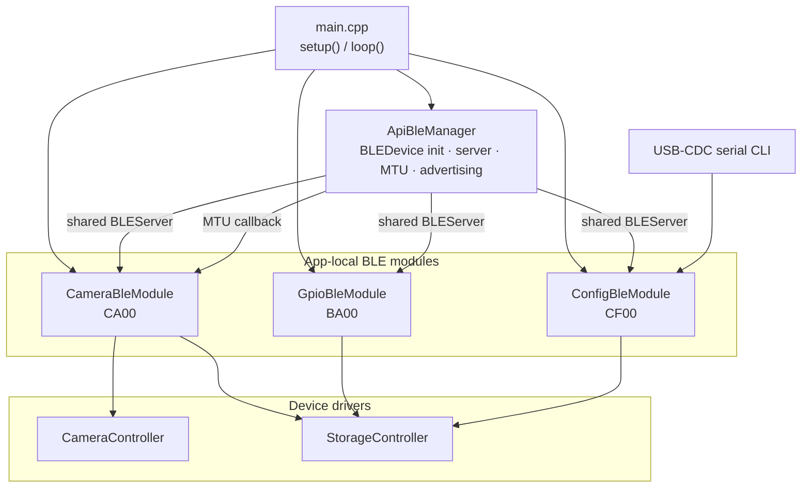
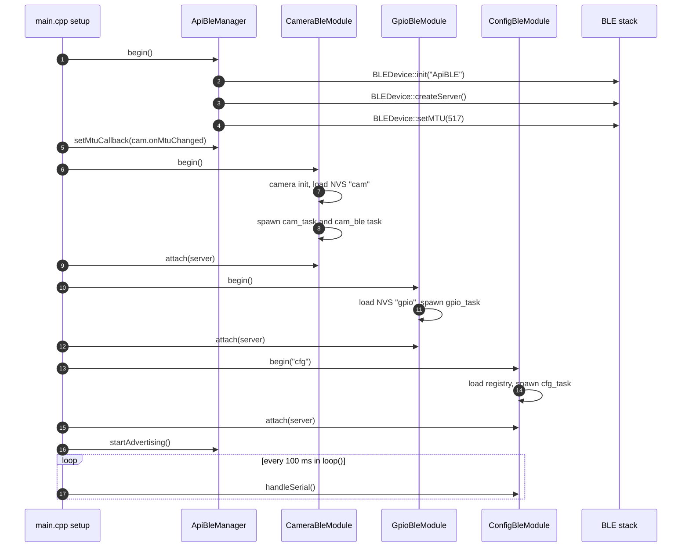
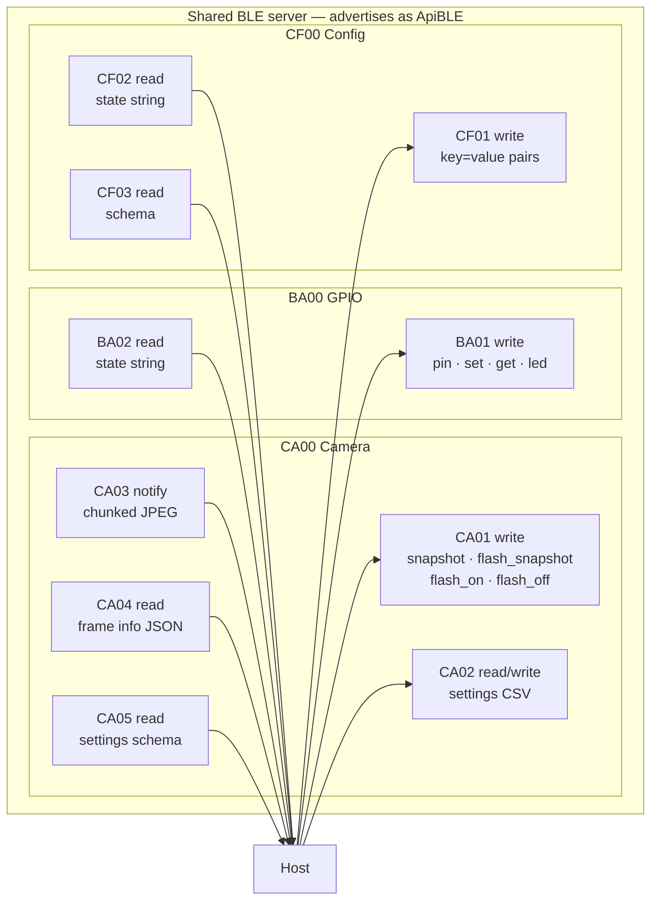
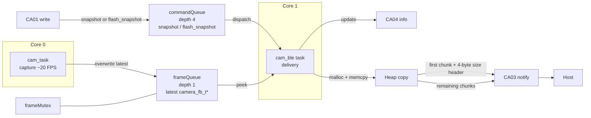
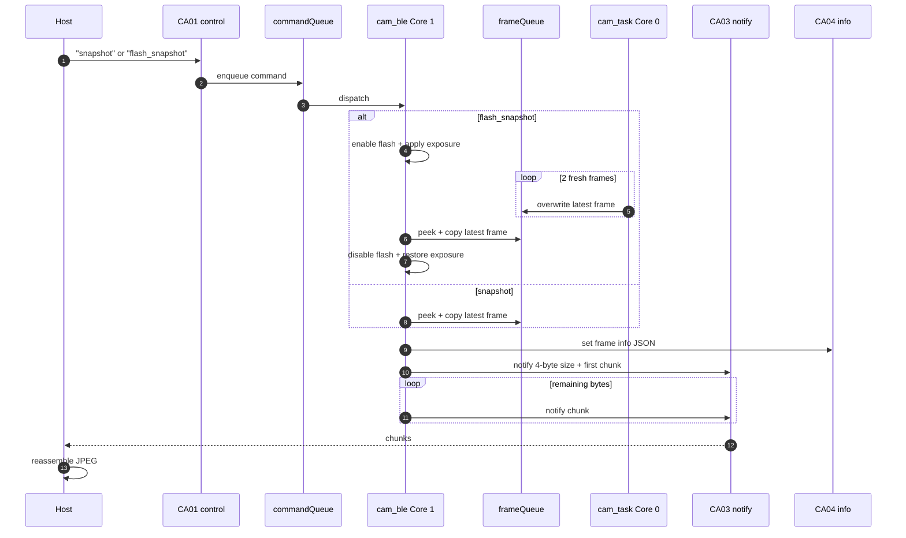
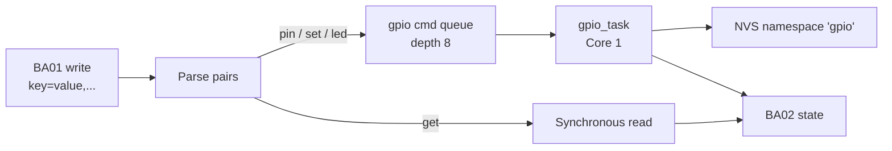
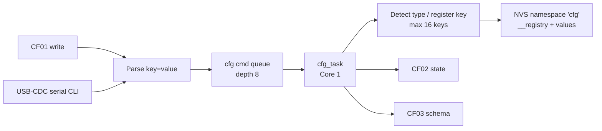
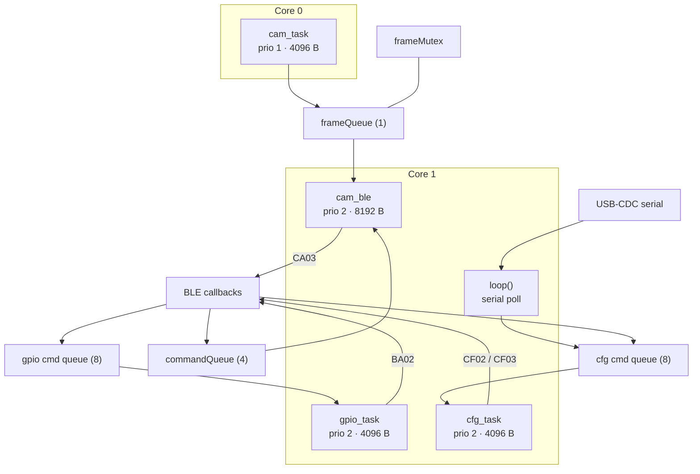

# Firmware Architecture

This document describes how the ESP32-S3 firmware in `firmware/` is structured, how
apps, services, and drivers compose, and how the **ApiBLE** reference application is
designed internally. It is a design document, not an API reference — see
[`README.md`](README.md), [`apps/README.md`](apps/README.md),
[`services/README.md`](services/README.md), and
[`device_drivers/README.md`](device_drivers/README.md) for per-directory usage.

## Contents

1. [Design principles](#design-principles)
2. [Platform layers](#platform-layers)
3. [Build and composition model](#build-and-composition-model)
4. [Execution model](#execution-model)
5. [ApiBLE reference application](#apible-reference-application)
6. [Boot sequence](#boot-sequence)
7. [BLE service map](#ble-service-map)
8. [Camera pipeline](#camera-pipeline)
9. [GPIO pipeline](#gpio-pipeline)
10. [Configuration pipeline](#configuration-pipeline)
11. [Queueing model](#queueing-model)
12. [Concurrency and resources](#concurrency-and-resources)
13. [Persistence map](#persistence-map)
14. [Constraints and extension points](#constraints-and-extension-points)
15. [Source map](#source-map)

## Design principles

- **One image runs.** Only an app under `firmware/apps/` is flashed and executed.
  Services and device drivers are libraries linked into that image at build time.
- **Layered dependencies.** Apps compose services and drivers; services compose
  drivers; drivers touch hardware.
- **One responsibility per library.** Camera capture, NVS persistence, display,
  ADC, LEDs, relays, and sensors each live in their own driver.
- **Text protocols where possible.** ApiBLE uses CSV-style `key=value` commands
  and JSON metadata so hosts are not tied to a binary wire format.
- **Settings survive resets.** Persistent state lives in ESP32 NVS through
  `StorageController`.
- **BLE-first for the reference app.** ApiBLE exposes camera, GPIO, and generic
  configuration over a single BLE server.

## Platform layers



Only the `Apps` layer is uploaded. The dashed host links are optional clients
used for testing and automation; the firmware is usable without them.

## Build and composition model

Each app is a standalone PlatformIO project. It declares where libraries live
with `lib_extra_dirs`, then imports only what its `main.cpp` needs:

```ini
; firmware/apps/<App>/platformio.ini
lib_extra_dirs =
    ../../services
    ../../device_drivers
```

`ApiBLE` is intentionally narrower — it links device drivers only:

```ini
lib_extra_dirs = ../../device_drivers
```

### App → service composition

| App | Services used | Drivers of note |
|---|---|---|
| `ApiBLE` | none (app-local BLE modules) | `CameraController`, `StorageController` |
| `CameraWebServerDemo` | `CameraWebServer` | `CameraController` |
| `MoistureMonitorDemo` | `MoistureMonitor` | `MoistureSensorController`, `DisplayController`, `StorageController` |
| `TimedCycleControllerDemo` | `TimedCycleController` | `RelayController`, `DisplayController`, `StorageController` |
| `StatusDashboardDemo` | `StatusDashboard` | `DisplayController` |
| `MoisturePump` | `MoistureMonitor`, `TimedCycleController` | `MoistureSensorController`, `RelayController`, `DisplayController`, `StorageController` |
| `StatusPanel` | `StatusDashboard` | `DisplayController`, `LedRGBController` |
| `MultiSensor` | none | `AdcController`, `DisplayController` |



External libraries are resolved by PlatformIO from each library's
`library.json` and from app-level `lib_deps`; they are not vendored in this
repository.

## Execution model

- **Runtime:** Arduino-ESP32 framework on the ESP32-S3, with FreeRTOS tasks and
  the Bluedroid BLE stack (`BLEDevice` / `BLEServer`).
- **Entry points:** `setup()` initializes hardware and services; `loop()` runs
  continuously and, in ApiBLE, polls the USB-CDC serial CLI.
- **Libraries:** service and driver code is statically linked into the app
  image. Nothing in `services/` or `device_drivers/` is flashed on its own.
- **Persistence:** NVS partitions are accessed through `StorageController`,
  which wraps `Preferences`.
- **Transport:** ApiBLE uses BLE for network I/O and also exposes a USB-CDC
  serial CLI. Other apps use WiFi (`CameraWebServer`, `StatusDashboard`) or pure
  local I/O (OLED/relay/sensor demos).

## ApiBLE reference application

ApiBLE combines three BLE modules on one shared server. Each module owns its BLE
service, its persistence namespace, and (where needed) its FreeRTOS tasks.



Module responsibilities:

| Module | BLE service | Responsibility | NVS namespace |
|---|---|---|---|
| `CameraBleModule` | `CA00` | Capture, sensor settings, chunked JPEG delivery | `cam` |
| `GpioBleModule` | `BA00` | Pin modes/read/write, optional NeoPixel | `gpio` |
| `ConfigBleModule` | `CF00` | Typed key/value configuration + serial CLI | `cfg` |

`ApiBleManager` creates the BLE server and configures advertising; modules
register their services on the shared `BLEServer` via `attach()`.

## Boot sequence



The `BLEServer*` returned by `BLEDevice::createServer()` is the shared server
used by each module's `attach()`. Advertising is restarted automatically after a
client disconnects (`ApiBleManager.cpp`).

## BLE service map

All services share one server and advertise as **ApiBLE**. UUID suffix
`-0000-1000-8000-00805f9b34fb` is omitted below for readability.

| Service | Characteristic | Properties | Payload |
|---|---|---|---|
| `CA00` Camera | `CA01` | Write | `snapshot`, `flash_snapshot`, `flash_on`, `flash_off` |
| | `CA02` | Read + Write | CSV settings, e.g. `quality=20,vflip=1,...` |
| | `CA03` | Notify | Chunked JPEG; first chunk starts with a 4-byte little-endian total size |
| | `CA04` | Read | Frame info JSON: `{"size":N,"w":W,"h":H,"q":Q}` |
| | `CA05` | Read | Settings schema JSON |
| `BA00` GPIO | `BA01` | Write | `pin=<n>:<out\|in\|ain>`, `set=<n>:<0\|1>`, `get=<n>`, `led=<color>` |
| | `BA02` | Read | State string, e.g. `led=no_led,pin1=1` |
| `CF00` Config | `CF01` | Write | `key=value,key=value,...` |
| | `CF02` | Read | Full state string |
| | `CF03` | Read | Schema: `key:type:default,...` |



### Camera settings

`CA02` accepts a comma-separated partial update with these keys:

`size`, `quality`, `brightness`, `contrast`, `saturation`, `effect`, `vflip`,
`hflip`, `wb`, `aec`, `shutter`, `gain`, `flash_gain`, `flash_shutter`,
`chunk_size`, `chunk_delay_ms`, `ble_mtu`.

`CA05` advertises a schema for the following subset: `quality`, `brightness`,
`contrast`, `saturation`, `effect`, `vflip`, `hflip`, `wb`, `aec`, `shutter`,
`gain`, `chunk_size`, `chunk_delay_ms`, `ble_mtu`. It does not currently include
`size`, `flash_gain`, or `flash_shutter`.

Most sensor-backed keys take effect immediately. `size` is persisted and applied
on the next boot; `flash_gain` and `flash_shutter` are consumed by
`flash_snapshot` and `flash_on`.
The chunk and MTU keys configure delivery, not the sensor.

Defaults at first boot: `QVGA`, JPEG quality `20`, `vflip=1`, `hflip=0`,
white balance `auto`, AEC `on`, auto chunk size, chunk delay `8 ms`, local MTU
cap `517`.

## Camera pipeline

The camera path is a producer–consumer pipeline designed to keep capture and BLE
delivery independent. The camera task always keeps the most recent frame ready.
A normal host snapshot request triggers delivery; `flash_snapshot` additionally
enables the LED, waits for fresh frames, copies one frame, and disables the LED
before BLE transmission.





Chunk sizing:

- `chunk_size=0` (default) auto-sizes to `mtu - 3 - 4`, using the negotiated MTU
  when known and the local `ble_mtu` cap before negotiation. The `- 4` reserves
  the 4-byte size header on the first notification.
- A fixed `chunk_size` is clamped to `20..510` bytes.
- `chunk_delay_ms` inserts a delay between notifications; lower values raise
  throughput but can drop chunks on weak links.
- `ble_mtu` caps the local ATT MTU (`23..517`) and is applied before advertising.

## GPIO pipeline

`BA00` uses a command queue so BLE callbacks stay short. Reads (`get=`) are
handled synchronously because they are fast and must return an up-to-date value.



Supported pin numbers on the ESP32-S3-CAM build are `1`, `14`, `40`, `41`, and
`42`; `40/41/42` are strapping pins, so avoid external pull-downs at boot.
NeoPixel support is compile-time optional via `HAS_NEOPIXEL` and is not enabled
in the ApiBLE `platformio.ini`.

## Configuration pipeline

`CF00` is a generic typed key/value store. BLE writes and serial CLI input share
one queue and one worker task. Types are inferred on first write and recorded in
a persisted registry.



Type inference: `true`/`false` (case-insensitive) → bool, an optionally signed
integer → int, a number with one `.` → float, everything else → String. Serial
commands supported by `ConfigBleModule` are `name`, `intv`, `enab`, `gain`,
`cfg`, `show`, and `clear`.

## Queueing model

ApiBLE uses FreeRTOS queues to move work out of the BLE callback context and into
module-owned worker tasks. Queues are created in each module's `begin()` before
its tasks start, so producers and consumers always have a valid handle. Command
queues copy fixed-size structs by value, which lets the BLE characteristic buffer
be reused as soon as the callback returns.

| Queue | Depth | Semantics | Producer | Consumer | Purpose |
|---|---:|---|---|---|---|
| `commandQueue` | 4 | FIFO; producer drops when full | CA01 BLE callback | `cam_ble` (core 1) | Serialize normal and flash snapshot requests |
| `frameQueue` | 1 | Overwrite under `frameMutex`; newest frame wins | `cam_task` (core 0) | `cam_ble` (core 1) | Keep the latest capture without a backlog |
| `gpio cmd queue` | 8 | FIFO; producer waits when full | BA01 BLE callback | `gpio_task` (core 1) | Serialize pin/LED changes and NVS writes |
| `cfg cmd queue` | 8 | FIFO; producer waits when full | CF01 BLE callback and USB-CDC CLI | `cfg_task` (core 1) | Serialize configuration and NVS writes |

### Latest-value vs command queues

The camera module uses a depth-1 `frameQueue` deliberately: it holds a single
`camera_fb_t*` and is overwritten, so `cam_ble` always works from the newest
capture rather than replaying stale frames. In contrast, `commandQueue` is a
depth-4 FIFO so a `flash_snapshot` request is not silently replaced by a later
`snapshot` request.

The frame pointer is shared, so `cam_task` overwrites it while holding
`frameMutex`, then releases the previous frame after the swap. `cam_ble` takes
the same mutex with a 500 ms timeout, peeks the queue, copies the JPEG and its
metadata into a heap buffer while the frame cannot be released, and drops the
mutex before chunking. There is no direct-capture fallback from the BLE task;
`cam_task` remains the sole owner of the camera frame pool. This bounds the
shared pipeline state to one queued frame plus one in-flight copy.

### Command queues

GPIO and configuration use depth-8 FIFO queues. Their BLE callbacks enqueue
`Command` values with `xQueueSend(..., portMAX_DELAY)`, so commands are processed
in arrival order and producers apply backpressure instead of silently dropping
work. The tradeoff is that a full queue blocks the producer, including the BLE
callback, until the worker drains an item. With eight slots and short,
user-driven commands, that wait is normally brief.

`gpio_task` receives with a 100 ms timeout, applies each command, saves state to
NVS, and refreshes BA02. `cfg_task` uses the same timeout, infers or registers
key types, writes values to NVS, and refreshes CF02/CF03. BLE writes and serial
CLI input share the config queue, so both paths are serialized through one
worker.

### Bypass paths

Not every operation is queued. BA01 `get=` is handled synchronously because it is
a fast read and BA02 must reflect the value immediately. CA02 settings and
`flash_on`/`flash_off` run directly in the BLE callback because they are short
state updates. `snapshot` and `flash_snapshot` are enqueued to `cam_ble`;
`flash_snapshot` owns the flash-on, warmup, frame-copy, and flash-off sequence.
On the serial path, `show` is handled synchronously while `clear` is enqueued.

Worker receive timeouts (10 ms for `cam_ble`, 100 ms for `gpio_task` and
`cfg_task`) let the tasks idle without busy-waiting. The resulting task/queue
topology is shown in [Concurrency and resources](#concurrency-and-resources).

## Concurrency and resources

| Task | Core | Priority | Stack | Created by | Role |
|---|---:|---:|---:|---|---|
| `cam_task` | 0 | 1 | 4096 B | `CameraBleModule` | Continuous capture (~20 FPS) into a depth-1 queue |
| `cam_ble` | 1 | 2 | 8192 B | `CameraBleModule` | Snapshot + flash-snapshot delivery, chunked BLE notifications |
| `gpio_task` | 1 | 2 | 4096 B | `GpioBleModule` | Drains GPIO command queue, persists state |
| `cfg_task` | 1 | 2 | 4096 B | `ConfigBleModule` | Drains config queue, updates NVS/state/schema |
| Arduino `loop()` | 1 | default | — | framework | Polls `ConfigBleModule::handleSerial()` every 100 ms |

Synchronization:

- `frameQueue` depth 1 + `frameMutex` protect the latest camera frame.
- `commandQueue` depth 4 serializes snapshot and flash-snapshot requests.
- GPIO and config queues have depth 8 and are drained by their own tasks.
- Most BLE callbacks enqueue work. Snapshot and flash-snapshot requests are
  queued; manual flash commands and CA02 settings are applied directly in the
  callback because those calls are fast.



## Persistence map

All three modules use `StorageController` over ESP32 NVS.

| Namespace | Owner | Keys |
|---|---|---|
| `cam` | `CameraBleModule` | `quality`, `brightness`, `contrast`, `saturation`, `effect`, `vflip`, `hflip`, `aec`, `shutter`, `gain`, `flash_gain`, `flash_shutter`, `chunk_size`, `chunk_delay_ms`, `ble_mtu` |
| `gpio` | `GpioBleModule` | `pins` (serialized `num:mode:value;...`), plus `led_pin` / `led_type` when NeoPixel is compiled in |
| `cfg` | `ConfigBleModule` | `__registry` (type registry) plus up to 16 user keys |

Settings are loaded during `begin()` and saved on every change, so BLE and serial
configuration survives reset and power loss.

## Constraints and extension points

Known constraints of the reference app:

- ApiBLE exposes BLE for network I/O plus a USB-CDC serial CLI; there is no
  WiFi, OTA, display, or filesystem layer.
- The camera keeps one queued frame at a time; the consumer always sees the
  latest frame, not every frame.
- JPEG delivery copies the whole frame to a heap buffer before chunking.
- `flash_snapshot` waits for two fresh frames (~100 ms at 20 FPS) before
  copying, so flash captures have a small fixed warmup delay.
- The config registry is limited to 16 keys, with 15-character names and
  31-character values.
- GPIO command values are limited to short strings; pin support is documented
  for the S3-CAM build, not enforced by a whitelist.
- NeoPixel support requires building with `HAS_NEOPIXEL`.

Adding a BLE module to ApiBLE:

1. Create `FooBleModule` with `begin()` and `attach(BLEServer*)`.
2. Give it its own service UUID and characteristics.
3. Persist state through `StorageController` in a dedicated namespace.
4. Instantiate it in `main.cpp`, call `begin()`, then `attach(mgr.server())`
   before `mgr.startAdvertising()`.

Adding a service library:

1. Create `firmware/services/<Name>/` with `library.json`, `README.md`, and
   `src/`.
2. Compose device drivers; do not touch hardware registers directly.
3. Add `../../services` to an app's `lib_extra_dirs` and include the service.

Adding a flashable app:

1. Create `firmware/apps/<Name>/` with `platformio.ini` and `src/main.cpp`.
2. Declare `lib_extra_dirs` for the services and drivers it needs.
3. Implement `setup()` / `loop()` and document the board in the app README.

## Source map

| File | Role |
|---|---|
| `apps/ApiBLE/platformio.ini` | Board, PSRAM/flash, USB-CDC, library paths |
| `apps/ApiBLE/src/main.cpp` | Object construction, `setup()`, serial poll in `loop()` |
| `apps/ApiBLE/src/ApiBleManager.h/.cpp` | BLE stack init, shared server, MTU, advertising |
| `apps/ApiBLE/src/CameraBleModule.h/.cpp` | CA00 service, camera settings, tasks, chunked JPEG |
| `apps/ApiBLE/src/GpioBleModule.h/.cpp` | BA00 service, pin/LED commands, GPIO NVS |
| `apps/ApiBLE/src/ConfigBleModule.h/.cpp` | CF00 service, typed registry, NVS, serial CLI |
| `device_drivers/CameraController/` | OV2640/OV3660 capture, sensor settings, frame buffers |
| `device_drivers/StorageController/` | NVS key/value CRUD wrapper |
| `services/` | Reusable libraries composed by demo/integration apps |
| `test/host/` | Host-side BLE protocol tests and throughput tooling |
